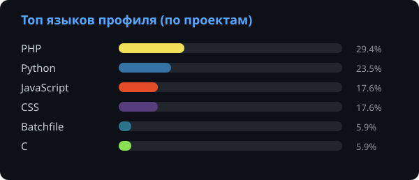

# Привет! Я Михаил

Я веб-разработчик с упором на практический результат, логику и сильное структурное мышление. Фронтенд и бэкенд привлекают меня возможностью мгновенно видеть плоды своей работы, тестировать код в реальном времени и доводить логику приложений до идеала.

### Мои сильные стороны

---

**Структурное мышление**
> *Вижу систему целиком, а не набор файлов.*

Обладаю способностью **видеть систему целиком**, раскладывать хаос по полочкам и организовывать код. Это помогает проектировать `чистую архитектуру` приложений — от простых `скриптов автоматизации` до полноценных `микрофреймворков`.

---

**Алгоритмическое мышление**
> *Сложная задача — это набор понятных шагов.*

Умею раскладывать сложные задачи на **понятные шаги**. Легко подбираю `системные решения` для кода и проектирую `архитектуру` — от скриптов автоматизации до собственных микрофреймворков.

---

**Комбинаторная интуиция**
> *Быстро вижу структуру там, где другие видят хаос.*

Обладаю способностью **быстро понимать структуру данных**, находить взаимосвязи в сложных условиях, эффективно работать с `массивами`, `объектами` и `группировкой элементов`.

---

**Итеративный подход** — `Практика > Сухая теория`
> *Сначала работает — потом красиво.*

Предпочитаю начинать с быстрого `рабочего прототипа`: собираю минимальную версию, проверяю, что логика верна, а затем `оптимизирую` и `улучшаю` её до нормального состояния. Такой цикл — от сырого наброска до чистого кода — позволяет быстрее увидеть результат и не увязнуть в преждевременной оптимизации.

---

**Нестандартные решения под давлением**
> *Когда шаблон не работает — ищу свой путь.*

В трудный момент, когда привычные подходы не дают результата, умею отходить от шаблона и находить `работающие неочевидные способы реализации`. Часто именно такие решения оказываются самыми эффективными.

### Мой стек технологий:
| Категория | Технологии |
| :--- | :--- |
| **Languages** |     |
| **Web & Backend** |      `ClearVC` • `API Integration` |
| **Инструменты** |    |
| **Изучаю** | `Laravel` • `Оптимизация` • `Безопасность веб-приложений` |

---

### Активность

<table>
  <tr>
    <td width="1000px">
      <table>
        График моей активности (приблизительный)
        <thead>
          <tr>
            <th>День недели</th>
            <th>Часы работы (UTC+4) +-</th>
            <th>Статус</th>
          </tr>
        </thead>
        <tbody>
          <tr>
            <td>🟢 Понедельник</td>
            <td>10:00 - 18:00</td>
            <td>Доступен для задач</td>
          </tr>
          <tr>
            <td>🟢 Вторник</td>
            <td>10:00 - 18:00</td>
            <td>Доступен для задач</td>
          </tr>
          <tr>
            <td>🟢 Среда</td>
            <td>10:00 - 18:00</td>
            <td>Доступен для задач</td>
          </tr>
          <tr>
            <td>🟢 Четверг</td>
            <td>10:00 - 18:00</td>
            <td>Доступен для задач</td>
          </tr>
          <tr>
            <td>🟢 Пятница</td>
            <td>10:00 - 18:00</td>
            <td>Доступен для задач</td>
          </tr>
          <tr>
            <td>🟠 Суббота</td>
            <td>10:00 - 15:00</td>
            <td>Частично</td>
          </tr>
          <tr>
            <td>🔴 Воскресенье</td>
            <td>Выходной</td>
            <td>Отдых</td>
          </tr>
        </tbody>
      </table>
    </td>
    <td>
       
    </td>
  </tr>
</table>

---

